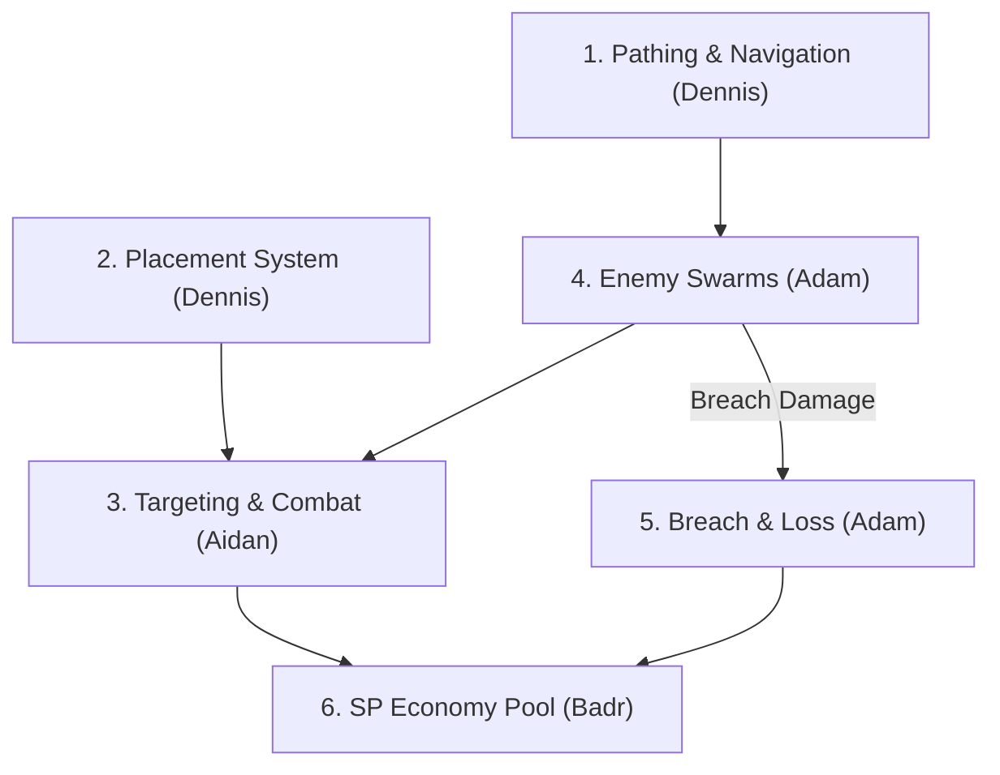

# Wizard Tower Defence - Game Design Document

**Working Title:** Wizard Tower Defence  

---

## 1. Game Objectives
* **Story:** The Dark Evil Wizard tries to take over the fortress. The White Wizard defends the fortress using trained magic apprentices.
* **Control Style:** The player does not control a character directly. Gameplay alternates between two views:
  1. **Battlefield View:** Watch incoming enemy waves, place apprentices, build barriers, combine units, and protect the fortress.
  2. **Skill Tree View:** Spend Skill Points (SP) to unlock new apprentices.
* **Win Condition:** Purchase the **Ultimate Skill (500 SP)** at the top of the skill tree to destroy the Dark Evil Wizard.
* **Loss Condition:** Enemy attacks drain your SP pool down to **`0 SP`**, destroying the fortress (Game Over).

---

## 1.1 Planned Features

Features are in categories:
* **`[REQUIRED]`**: Essential core features for the **Playable Prototype (CW1)**.
* **`[ADDITIONAL]`**: Advanced systems and mechanics for the **Final Game (CW2)**.
* **`[UNAPPROVED]`**: Design modifications from standard tower defence mechanics awaiting approval.

---

### 1. Apprentice / Unit Placement System
* **1.1 Battlefield Direct Placement `[REQUIRED]`**: You can place Level 0 recruits directly onto the battlefield for a 20 SP fee. They fight by throwing stones.
* **1.2 Apprentice Placement Limits `[REQUIRED]`**: There is a fixed maximum limit of apprentices you can place on the battlefield and bench.
* **1.3 Placement Controls & HUD Feedback `[REQUIRED]`**:
  * **HUD Placement Toggle Button**: A dedicated button on the HUD to enter and cancel recruit placement mode.
  * **Cursor Highlight Validation**: A grid cursor outline that changes colour dynamically (Green for valid placement, Red for invalid/blocked/path/limit reached).
  * **HUD Floating Deduction Text**: Animated visual feedback (-20 SP) that pops up on the HUD when a recruit is placed.
  * **Live Recruit Counter**: An on-screen HUD counter tracking active placed apprentices against the maximum placement limit.
* **1.4 Apprentice Non-Death Rule `[UNAPPROVED]`**: Once placed on the battlefield, apprentices don't die. But can be locked if they aren't in the right milestone. They remain on the field to attack enemies continually.
* **1.5 Reserve Bench Placement `[ADDITIONAL]`**: Recruits wait on the bench. While unplaced, they generate an increased amount of SP ($1.5\times$ kill value).
* **1.6 Field Apprentice Upgrades `[ADDITIONAL]`**: You can upgrade apprentices directly on the battlefield by paying their small upgrade fee (100 SP for Lvl 1, 150 SP for Lvl 2, 200 SP for Lvl 3).

### 2. Pathing & Navigation System
* **2.1 Grid Paths & Edge Spawning `[REQUIRED]`**: Enemies spawn at the edge of the map and walk along grid paths toward the fortress in the centre.
  * **3 Distinct Lanes**: The three structured spawn lanes (North, South, and East paths).
* **2.2 Fortress Breach & Attack Damage `[REQUIRED]`**: When an enemy reaches the fortress, it does attack damage directly against the SP pool and dies immediately.
* **2.3 Obstacle & Roadblock Interactions `[ADDITIONAL]`**: Imaginary walls are physical roadblocks where enemies stop infront and attack the wall until it breaks before continuing toward the fortress.

### 3. Combat, Spells & 4 Magic Specialiations
* **3.1 Level 0 Recruit Combat `[REQUIRED]`**: Level 0 Basic Recruit throws stones to defend the path and eliminate enemy health bars.
* **3.2 Physical Magic Specialisation `[ADDITIONAL]`**: Damage Dealer that shoots fast Energy Bolts that deal damage to targets, eliminating enemy health bars quickly.
* **3.3 Mechanic Magic Specialisation `[ADDITIONAL]`**: Crowd Pusher that uses physics force to lift enemies and throw them backward along their path, pushing enemies away from the fortress and dealing a small amount of damage.
* **3.4 Magic Specialisation `[ADDITIONAL]`**: Crowd Stunner that traps enemies in floating bubbles, lifting them into the air so they can't move or attack, freezing fast or dangerous enemies in place.
* **3.5 Imaginary Magic Specialisation `[ADDITIONAL]`**: Barrier Builder that spawns physical walls directly on the path which enemies need to break to progress, blocking enemies and absorbing incoming attacks.
* **3.6 3-to-1 Super Apprentice Fusion `[ADDITIONAL]`**: Combine 3x Level 3 apprentices of the exact same specialisation branch either on the bench or the battlefield to merge all 3 units together ($3\times$) and apply a $2\times$ Super bonus multiplier ($6\times$ power output).
* **3.7 1:1 Counter Weakness Matrix `[ADDITIONAL]`**: 1:1 Weakness Matrix ($2\times$ Multipliers) where Grunt takes $2\times$ damage from Physical, Juggernaut takes $2\times$ throw distance from Mechanic, Sprint takes $2\times$ bubble duration from Magic, and Disrupt takes $2\times$ wall collision damage from Imaginary.

### 4. Enemy Archetypes & Attack Damage
* **4.1 Grunt Archetype `[REQUIRED]`**: Standard infantry that attacks in groups, dealing 8 SP attack damage to the fortress.
* **4.2 Sprint Archetype `[ADDITIONAL]`**: Fast runner that runs quickly across the path toward the fortress, dealing 5 SP attack damage to the fortress.
* **4.3 Disrupt Archetype `[ADDITIONAL]`**: Anti-magic specialist that counters magic energy, dealing 12 SP attack damage to the fortress.
* **4.4 Juggernaut Archetype `[ADDITIONAL]`**: Heavily armoured tank with massive health, dealing 25 SP attack damage to the fortress.

### 5. SP Economy & Fortress Health Pool
* **5.1 Dual-Function Energy Pool `[UNAPPROVED]`**: Skill Points (SP) are the currency pool, and health of the fortress.
* **5.2 Base SP & Kill SP `[REQUIRED]`**: Starting base health is 100 SP, enemy kills on award SP (+SP per kill).
* **5.3 Fortress Attack Deductions `[REQUIRED]`**: When enemies attack the fortress, they deduct SP directly from the pool (Sprint $-5$, Grunt $-8$, Disrupt $-12$, Juggernaut $-25$).
* **5.4 Benched Apprentice Passive Generation `[ADDITIONAL]`**: Recruits benched generate $1.5\times$ the total SP rewarded in that wave. This is to increase acceleratation for reaching milestones and fund upgrades whilst not defending the path.
* **5.5 Milestone Unlocks & Thresholds `[ADDITIONAL]`**: The fortress SP pool is a progress meter which unlocks milestones at 100 SP (Level 0 Recruit), 250 SP (Level 1 Apprentice), 350 SP (Level 2 Veteran), 400 SP (Level 3 Master), and 500 SP (Ultimate Skill).
* **5.6 Milestone Re-Locking & Regression `[ADDITIONAL]`**: If an attack puts your SP pool below an active milestone, that tier in the skill tree locks again until you regain enough SP to reach the milestone threshold.

### 6. Game Objectives & Views
* **6.1 Dual-View Gameplay `[ADDITIONAL]`**: The player does not control a character. The gameplay alternates between Battlefield View (watch incoming enemy waves, place apprentices, build barriers, combine units, protect fortress) and Skill Tree View (spend SP to unlock new apprentices).
* **6.2 Win Condition `[ADDITIONAL]`**: Purchase the Ultimate Skill (500 SP) at the top of the skill tree to destroy the Dark Evil Wizard and win the game.
* **6.3 Loss Condition `[REQUIRED]`**: Enemy attacks decrease the SP pool down to 0 SP, which destroys the fortress and ends the game.

---

## 1.2 Identifying Core Features

The core features represent the minimal **`[REQUIRED]`** systems targeted to test that the game is playable and fun within the **2 week prototype window**:

### Core Feature Responsibilities

| Core Feature | Lead Member | Targeted Prototype Scope (CW1) |
| :--- | :--- | :--- |
| **1. Placement System `[REQUIRED]`** | **Dennis** | Place Level 0 recruits onto the battlefield for a 20 SP fee, making sure the fixed maximum limit works. |
| **2. Pathing & Navigation `[REQUIRED]`** | **Dennis** | Enemies spawn at the edge of the map and walk along grid paths to the centre fortress. |
| **3. Targeting & Combat `[REQUIRED]`** | **Aidan** | Level 0 recruits fight incoming enemies by throwing stones to defend the path and eliminate enemy health bars. |
| **4. Enemy Swarms `[REQUIRED]`** | **Adam** | Grunt infantry attack in groups on the path toward the fortress. |
| **5. Attack & Loss Condition `[REQUIRED]`** | **Adam** | Enemies reaching the fortress deduct SP and die instantly. Reaching 0 SP destroys the fortress (Game Over). |
| **6. SP Economy Pool `[REQUIRED]`** | **Badr** | Fortress SP pool (100 Base), where kills on battlefield award SP and placement/attacks deduct SP. |

### Feature Structure & Dependencies

### 2-Week Feasibility Statement
By focusing strictly on Level 0 recruits throwing stones, Grunt swarms walking along the grid paths, and the 100 SP fortress pool, the prototype only includes the essential game features to function, which fits within the 2-week CW1 window (~12 hours of development effort per member). All advanced systems from the implementation plan including the 4 magic specialisations, $1.5\times$ bench passive generation, 3-to-1 Super Fusion ($6\times$ power), and milestone regression are reserved for the final game (CW2).
