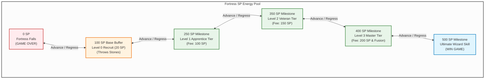
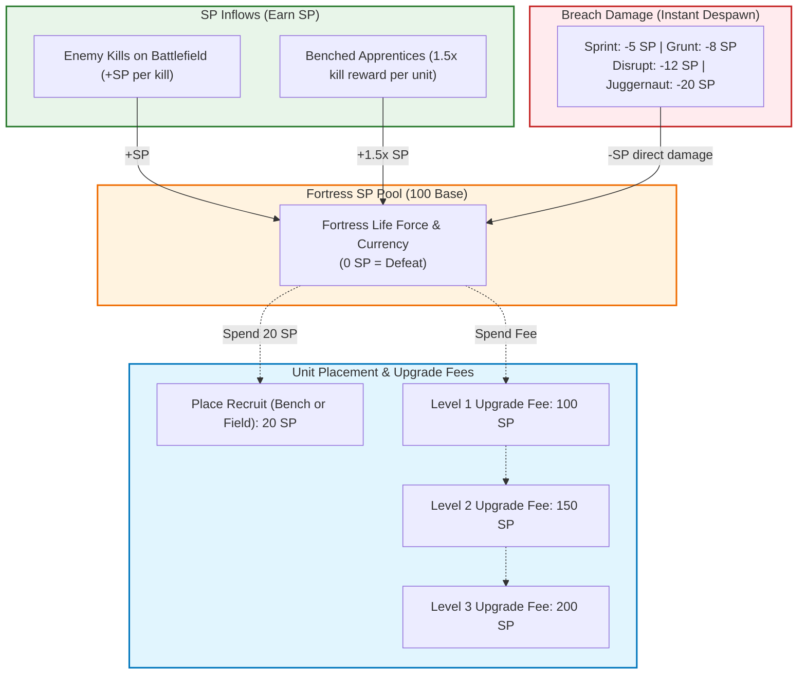

# Tower Defence: Implementation Plan

## 1. Game Objectives
* **Story:** The Dark Evil Wizard tries to take over the fortress. The White Wizard defends the fortress using trained magic apprentices.
* **Control Style:** The player does not control a character directly. Gameplay alternates between two views:
  1. **Battlefield View:** Watch incoming enemy waves, place apprentices, build barriers, combine units, and protect the fortress.
  2. **Skill Tree View:** Spend Skill Points (SP) to unlock new apprentices.
* **Win Condition:** Purchase the **Ultimate Skill (500 SP)** at the top of the skill tree to destroy the Dark Evil Wizard.
* **Loss Condition:** Enemy attacks drain your SP pool down to **`0 SP`**, destroying the fortress (Game Over).

---

## 2. The SP Economy & Flow Graph

Skill Points (SP) are the **currency pool, and health of the fortress**.

---

### A. How You Gain SP & The $1.5\times$ Bench Generation

1. **Recruit Placement Cost (Bench or Field):**
   * Placing any Level 0 Recruit costs **20 SP** (deducted from the fortress pool).
   * Starting with 100 SP, hiring your first recruit leaves **80 SP** of fortress health.
2. **Enemy Kill Rewards vs. Bench Generation:**
   * Keeping your recruit on the bench won't let you use them but they will generate $1.5\times$ the SP. How each enemy impacts SP pool/health: 

| Enemy Archetype | Attack Penalty (Loss) | Kill SP Reward (Field) | Bench Generation ($1.5\times$ Kill Value) |
| :--- | :---: | :---: | :---: |
| **`Sprint`** (Fast runner) | **$-5$ SP** | **$+2$ SP** | **$+3$ SP** *(Clean integer)* |
| **`Grunt`** (Standard swarmer) | **$-8$ SP** | **$+4$ SP** | **$+6$ SP** *(Clean integer)* |
| **`Disrupt`** (Anti-magic) | **$-12$ SP** | **$+8$ SP** | **$+12$ SP** *(Clean integer)* |
| **`Juggernaut`** (Heavy siege) | **$-20$ SP** | **$+16$ SP** | **$+24$ SP** *(Clean integer)* |

* **The Strategic Element:**
  * **On the field:** Recruits defend the path, preventing attacks.
  * **On the bench:** Recruits benched generate **$1.5\times$** the total SP rewarded in that wave. This is used to accelerate reaching milestones and fund upgrades whilst not defending the path.

---

### B. Skill Tree Milestones vs. Apprentice Upgrade Fees

#### 1. Skill Tree Milestones (Pool Thresholds)
The fortress SP pool is a progress meter. When you achieve a new milestone you unlock the ability to train apprentices:
* **100 SP (Starting Base):** Unlocks **Level 0 Recruit** (20 SP to place, throws stones).
* **250 SP Pool:** Unlocks **Level 1 Apprentice** (Physical, Mechanic, Magic, Imaginary).
* **350 SP Pool:** Unlocks **Level 2 Veteran** (+25% power and hit speed).
* **400 SP Pool:** Unlocks **Level 3 Master** (+50% power and hit speed & unlocks 3-to-1 Super Fusion).
* **500 SP Pool:** Unlocks the **Ultimate Skill** to defeat the Dark Evil Wizard and **Win the Game**.

#### 2. Small Apprentice Upgrade Fees (Deducted from Pool)
Once a tier is unlocked in your skill tree, you pay a fee per apprentice to upgrade them:

| Action / Tier | Prerequisite Pool | SP Cost / Fee | What It Unlocks |
| :--- | :---: | :---: | :--- |
| **Place Level 0 Recruit** | **100 SP Base** | **20 SP** | Deploy recruit to bench (passive SP) or field (stone-thrower). |
| **Upgrade to Level 1** | **250 SP** | **100 SP** | **Specialisation:** Select one of 4 branches (*Physical, Mechanic, Magic, or Imaginary*). |
| **Upgrade to Level 2** | **350 SP** | **150 SP** | **Veteran Status:** $+25\%$ spell damage and cast rate. |
| **Upgrade to Level 3** | **400 SP** | **200 SP** | **Master Status:** $+50\%$ damage/area, and **unlocks 3-to-1 Super Fusion**. |
| **Ultimate Skill** | **500 SP** | **Goal Met** | **Game Victory:** Casts the final spell that kills the Dark Evil Wizard. |

---

### C. Attacks & Skill Regression
* When enemies attack the fortress, they deduct SP directly from the pool (Sprint $-5$, Grunt $-8$, Disrupt $-12$, Juggernaut $-20$).
* **Milestone Re-Locking:**
  * If an attack puts your SP pool below an active milestone (e.g., from 152 SP down to 144 SP), that tier in the skill tree locks again until you regain enough SP to reach 150 SP.
* **LIFO Regression on Negative SP:**
  * If your SP pool regresses below an active milestone, using, training, and upgrading apprentices is locked until you reach the milestone threshold.
  * If attacks bring your pool **below 0 SP**:
    * You must defeat enemies to regain SP or else you lose.
* **Fortress Destruction (Defeat):**
  * If your pool is brought down to **0 SP** (all 100 base SP lost) $\rightarrow$ **Game Over**.

---

## 3. The 4 Apprentices

### A. The 4 Level 1 Specialisations (Unlocked at 150 SP, 25 SP Fee)

| Magic Type | Combat Role | Level 1 Spell Behaviour | Best Strategic Use |
| :--- | :--- | :--- | :--- |
| **Physical** | Damage Dealer | Shoots fast **Energy Bolts** that deal damage to targets. | Eliminating enemy health bars quickly. |
| **Mechanic** | Crowd Pusher | Uses physics force to lift enemies and throw them backward along their path. | Pushing enemies away from the fortress and dealing a small amount of damage. |
| **Magic** | Crowd Stunner | Traps enemies in floating bubbles, lifting them into the air so they can't move or attack. | Freezing fast or dangerous enemies in place. |
| **Imaginary** | Barrier Builder | Spawns physical walls directly on the path. Which enemies need to break to progress. | Blocking enemies and absorbing incoming attacks. |

### B. Apprentice Deployment Rules
* **Bench:** Recruits wait on the bench. While unplaced, they generate an increased amount of SP.
* **Direct Placement:** You can place Level 0 recruits directly onto the battlefield for a 20 SP fee. They fight by throwing stones.
* **Field Upgrades:** You can upgrade apprentices directly on the battlefield by paying their small upgrade fee (100 SP for Lvl 1, 150 SP for Lvl 2, 200 SP for Lvl 3).
* **Apprentice Limits:** There is a fixed maximum limit of apprentices you can place on the battlefield and bench.
* **Apprentices Can't Die:** Once placed on the battlefield, apprentices don't die. But can be locked if they aren't in the right milestone. 

---

## 4. 3-to-1 Super Apprentice Fusion (Level 3 Units Only)

* **Rule:** Combine **3x Level 3 apprentices** of the **exact same specialisation branch**.
* **Level Requirement:** Must be Level 3 (unlocked at 400 SP milestone, upgraded with 200 SP fee). Levels 0, 1, and 2 can't fuse.
* **Where to Fuse:** Either on the bench or the battlefield.
* **The Fusion Math ($3 \times 2\times = 6\times$):**
  * 3 individual Level 3 units produce $3.0\times$ power.
  * When fused, the Super Apprentice merges all 3 units together ($3\times$) and applies a $2\times$ Super bonus multiplier:
    $$\text{Total Super Power} = 3 \times 2\times = \mathbf{6\times} \text{ of a single Level 3 Apprentice}$$

### Super Apprentice Spells Table

| Magic Branch | Super Title | Empowered Super Spell | Field Power ($6\times$ Level 3 Output) |
| :--- | :--- | :--- | :--- |
| **Physical** | Super Physical | **Piercing Rail-Blast** | Fires a beam dealing **$6\times$ Level 3 damage** through lines of enemies, exploding on final impact. |
| **Mechanic** | Super Mechanic | **Gravitational Slam** | Hurls enemy clusters backward with **$6\times$ Level 3 throw force & distance**, impacting wave progress. |
| **Magic** | Super Magic | **Stasis Storm** | Suspends entire enemy waves in midair with **$6\times$ Level 3 bubble radius and duration**, freezing them completely. |
| **Imaginary** | Super Imaginary | **Fortified Wall** | Manifests a massive fortress wall with **$6\times$ Level 3 durability (x HP)** that blocks paths and requires heavy damage to break. |

---

## 5. Enemy Archetypes, 1:1 Weaknesses & Attack Damage

### The 4 Enemy Archetypes
1. **`Sprint`:** Fast runner that runs quickly across the path towards the fortress.
2. **`Grunt`:** Standard infantry that attacks in groups.
3. **`Disrupt`:** Anti-magic specialist that counters magic energy.
4. **`Juggernaut`:** Heavily armoured tank with massive health.

### 1:1 Weakness Matrix ($2\times$ Multipliers)

| Enemy Archetype | Main Threat | Weakness | Detailed Mechanical Weakness Effect |
| :--- | :--- | :--- | :--- |
| **`Grunt`** | Pushes in large groups | **Physical** | **$2\times$ Damage:** Grunts have basic armour. Energy bolts deal double damage. |
| **`Juggernaut`** | Heavy armour and high health | **Mechanic** | **$2\times$ Throw Distance:** Armour does not stop physics force. Mechanic spells throw the Juggernaut twice as far back. |
| **`Sprint`** | Moves quickly | **Magic** | **$2\times$ Bubble Duration:** Sprint relies entirely on movement speed. Magic bubbles keep Sprint floating in midair for twice as long. |
| **`Disrupt`** | Cancels magic energy | **Imaginary** | **$2\times$ Wall Collision Damage:** Disrupt can only cancel magical energy. Imaginary walls are physical objects, so Disrupt cannot cancel them. When Disrupt hits a wall, it takes double damage from the impact. |

---

## 6. Fortress Attack Damage Table (Deducted from the SP Pool)
When an enemy reaches the fortress, it does attack damage directly against the SP pool and **dies immediately**:

| Enemy Archetype | Attack Damage (SP Deducted) | Balance Rationale |
| :--- | :---: | :--- |
| **`Sprint`** | **5 SP** | Fast but fragile. Requires 20 solo attacks to drain the base 100 SP alone. |
| **`Grunt`** | **8 SP** | Standard infantry swarmer. A dense swarm reaching the fortress quickly drains SP. |
| **`Disrupt`** | **12 SP** | Anti-magic explodes upon reaching the fortress, dealing medium-high SP damage. |
| **`Juggernaut`** | **20 SP** | Massive ram. Dangerous threat that drains 20 SP per attack (5 attacks destroy the fortress). |

---

## 7. Pathing Mechanics

* **Grid Paths & Enemy Movement:** Enemies spawn at the edge of the map and walk along grid paths towards the fortress in the centre.
* **Attack Obstacle Logic:**
  * **Imaginary Walls:** Physical roadblocks. Enemies stop in front and attack the wall until it breaks before continuing towards the fortress.
  * **Magic Bubbles:** Lifts enemies into midair, preventing movement or attacks until the bubble pops.
  * **Mechanic Throws:** Brings enemies backward down the path, forcing them to re-walk.
  * **Apprentices:** Apprentices can't die. They remain on the field to attack enemies continually.

---

## 8. Enemy Wave Progression & Health Scaling

### A. Health Scaling Progression
Enemy health increases from **Round 3**, and then steadily gains difficulty:
* **Standard (Grunt):** 100 HP base; flat for Rounds 1–2; gains **+20 HP** each round starting from Round 3.
* **Sprint:** 50 HP base; debuts on **Round 3** at base health; gains **+10 HP** each round starting from Round 4.
* **Juggernaut:** 400 HP base; debuts on **Round 5** at base health; gains **+50 HP** each round starting from Round 6.

| Wave | Standard Enemy (+20/wave) | Sprint Enemy (+10/wave) | Juggernaut Enemy (+50/wave) |
| :---: | :---: | :---: | :---: |
| **Wave 1** | **100 HP** | *(not spawning)* | *(not spawning)* |
| **Wave 2** | **100 HP** *(flat base)* | *(not spawning)* | *(not spawning)* |
| **Wave 3** | **120 HP** | **50 HP** *(debut base)* | *(not spawning)* |
| **Wave 4** | **140 HP** | **60 HP** | *(not spawning)* |
| **Wave 5** | **160 HP** | **70 HP** | **400 HP** *(debut base)* |
| **Wave 6** | **180 HP** | **80 HP** | **450 HP** |

### B. Wave-Tiered Spawn Distribution
* **Waves 1–2:** 100% Standard enemies.
* **Waves 3–4:** 50% Standard enemies, 50% Sprint enemies.
* **Waves 5+:** 47.5% Standard enemies, 32.5% Sprint enemies, 20% Juggernaut enemies.

### C. Movement Speeds
* **Standard (Grunt):** 2.0 units/s
* **Sprint:** 4.0 units/s
* **Juggernaut:** 1.25 units/s
